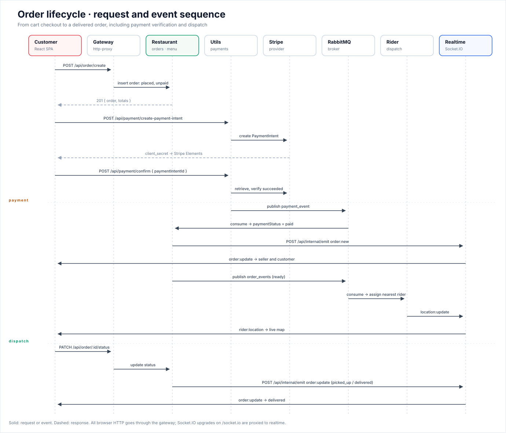

# JettyOrders

Food delivery platform split into seven services behind an API gateway. Customers browse restaurants, place orders and pay with Stripe. Restaurant owners manage their menu and incoming orders. Riders receive dispatches, set availability and stream their location. Admins verify restaurants and riders.

React 19 · TypeScript · Express 5 · Node.js 22 · MongoDB · RabbitMQ · Socket.IO · Stripe · FastAPI

## Tech stack

**Frontend**


**Backend**


**AI**


**Infrastructure**


| Layer | Libraries and services |
|---|---|
| Frontend | React 19, React Router 7, Vite 8, Tailwind CSS 4, Axios, Zod, `@stripe/react-stripe-js`, `@stripe/stripe-js`, `socket.io-client`, Leaflet + React Leaflet + `leaflet-routing-machine`, `react-icons`, `react-hot-toast`, `@react-oauth/google`, `react-ga4`, `@sentry/react`; linted with `oxlint` |
| UI icons | `react-icons` with Bootstrap Icons (`bi`), BoxIcons (`bs`), css.gg (`cg`), Font Awesome (`fc`), Heroicons (`hi`), Ionicons 5 (`io5`) and Lucide (`lu`); Google sign-in uses the Font Awesome Google mark and maps use Leaflet markers |
| Backend | Node.js 22, Express 5, Mongoose 9, `amqplib`, `socket.io`, `stripe`, `cloudinary` + `datauri`, `jsonwebtoken`, `bcryptjs`, `googleapis`, `nodemailer`, `express-rate-limit`, `@upstash/redis`, `pino` + `pino-http`, `@sentry/node`, `multer`, `http-proxy` |
| AI | Python 3.12, FastAPI, Uvicorn, LangChain, `langchain-groq`, LangSmith, Pydantic v2, PyJWT, SlowAPI, Upstash Redis |
| Infrastructure | Docker Compose, MongoDB 7, RabbitMQ 3.13 management, nginx 1.27 |

## Architecture


The browser calls the gateway on `:5007` for REST traffic. Socket.IO upgrades on `/socket.io` are proxied to the realtime service on `:5005`, which owns all rooms (`user:{id}`, `restaurant-{id}`). Each service owns its collections and talks to the others over HTTP or through RabbitMQ; MongoDB is shared storage, not an integration point. Traffic to Stripe, Cloudinary, Groq, Google and SMTP leaves from the service that owns that dependency.

`/api/internal` is service-to-service only. It requires `INTERNAL_SERVICE_KEY` and is not routed by the gateway.

## Order lifecycle



1. `POST /api/order/create` writes an unpaid order and calculates distance, delivery fee, platform fee and rider payout.
2. Utils creates a Stripe PaymentIntent. The browser confirms it with Stripe Elements.
3. `POST /api/payment/confirm` retrieves the intent, verifies the amount and publishes `payment_event`.
4. The restaurant payment consumer marks the order paid, then emits `order:new` to the seller and customer rooms through realtime.
5. When the kitchen marks the order ready, `order_events` is published. The rider consumer assigns the nearest available rider.
6. The rider accepts and moves the order through `picked_up` and `delivered`. Location updates are relayed to the customer's room.
7. Every status change is written by the restaurant service and broadcast by realtime.

Stripe can also send the browser back after 3-D Secure. `OrderConfirmation` reads `payment_intent` and `redirect_status`, then calls the same idempotent confirm endpoint.

## Services

| Service        | Port | Responsibility                                                                               |
| -------------- | ---- | -------------------------------------------------------------------------------------------- |
| `auth`       | 5000 | Registration, email/password and Google login, JWT access and refresh tokens, password reset |
| `restaurant` | 5001 | Restaurants, menu items, carts, addresses, order creation and status, payment consumer       |
| `utils`      | 5002 | Stripe PaymentIntents, Cloudinary uploads, payment event producer                            |
| `ai`         | 5003 | Dish suggestions, restaurant suggestions and review generation                               |
| `rider`      | 5004 | Rider registration, availability, location, order acceptance and delivery                    |
| `realtime`   | 5005 | Socket.IO rooms, order events, rider location relay                                          |
| `admin`      | 5006 | Pending restaurant/rider review and verification                                             |
| `gateway`    | 5007 | Reverse proxy and Socket.IO upgrade routing                                                  |
| `frontend`   | 5173 | React SPA served by nginx                                                                    |

## Repository layout

```
.
├── docker-compose.yml
├── docs/                     architecture and order-flow drawings
├── frontend/                 React SPA, nginx image
├── scripts/                  automated end-to-end flow runner
└── services/
    ├── auth/                 users, JWT, OAuth, SMTP
    ├── restaurant/           core order domain and payment consumer
    ├── utils/                payments and uploads
    ├── ai/                   FastAPI service
    ├── rider/                dispatch and delivery
    ├── realtime/             Socket.IO server
    ├── admin/                verification API
    └── gateway/              HTTP + WebSocket proxy
```

## Run with Docker

Prerequisites: Docker Desktop (or Docker Engine with Compose v2).

Each service reads credentials from its own `.env` file. Compose overrides database, broker and service URLs with container DNS names, so the same files work for local development.

```bash
docker compose build
docker compose up -d
docker compose ps
```

| URL                          | What                                                   |
| ---------------------------- | ------------------------------------------------------ |
| http://localhost:5173        | Web app                                                |
| http://localhost:5007/health | Gateway                                                |
| http://localhost:15672       | RabbitMQ management (`jetty` / `jetty` by default) |
| mongodb://localhost:27017    | MongoDB                                                |

All containers expose `/health`. `docker compose ps` shows the health state; `docker compose logs -f <service>` follows one service.

```bash
# Stop and keep data
docker compose down

# Stop and delete MongoDB/RabbitMQ volumes
docker compose down -v
```

Compose-level values (build-time frontend keys, broker credentials, database name) can be set in a root `.env`. Start from `.env.example`.

## Configuration

| File | Required keys | Optional keys |
|---|---|---|
| `services/auth/.env` | `MONGO_URI`, `JWT_SECRET`, `GOOGLE_CLIENT_ID`, `GOOGLE_CLIENT_SECRET` | `SMTP_HOST`, `SMTP_PORT`, `SMTP_USER`, `SMTP_PASS`, `SMTP_FROM` (password-reset email), `UPSTASH_REDIS_REST_URL`, `UPSTASH_REDIS_REST_TOKEN` |
| `services/restaurant/.env` | `MONGO_URI`, `JWT_SECRET`, `INTERNAL_SERVICE_KEY`, `UTILS_SERVICE`, `RABBITMQ_URL`, `REALTIME_SERVICE_URL`, `PAYMENT_QUEUE`, `ORDER_EVENT_QUEUE` | `UPSTASH_REDIS_REST_URL`, `UPSTASH_REDIS_REST_TOKEN` |
| `services/utils/.env` | `CLOUDINARY_CLOUD_NAME`, `CLOUDINARY_API_KEY`, `CLOUDINARY_API_SECRET`, `RABBITMQ_URL`, `INTERNAL_SERVICE_KEY`, `RESTAURANT_SERVICE`, `STRIPE_SECRET_KEY`, `PAYMENT_QUEUE`, `JWT_SECRET` | `UPSTASH_REDIS_REST_URL`, `UPSTASH_REDIS_REST_TOKEN` |
| `services/ai/.env` | `GROQ_API_KEY`, `JWT_SECRET` | `LANGSMITH_TRACING`, `LANGSMITH_ENDPOINT`, `LANGSMITH_API_KEY`, `LANGSMITH_PROJECT`, `HTTP_PROXY`, `HTTPS_PROXY`, `UPSTASH_REDIS_REST_URL`, `UPSTASH_REDIS_REST_TOKEN` |
| `services/rider/.env` | `MONGO_URI`, `JWT_SECRET`, `INTERNAL_SERVICE_KEY`, `RESTAURANT_SERVICE`, `UTILS_SERVICE`, `RABBITMQ_URL`, `REALTIME_SERVICE_URL`, `ORDER_EVENT_QUEUE` | `UPSTASH_REDIS_REST_URL`, `UPSTASH_REDIS_REST_TOKEN` |
| `services/realtime/.env` | `JWT_SECRET`, `RIDER_SERVICE_URL`, `INTERNAL_SERVICE_KEY` | — |
| `services/admin/.env` | `MONGO_URI`, `JWT_SECRET` | — |
| `services/gateway/.env` | service URLs only; Compose supplies them | — |
| `frontend/.env` | only for local Vite development; the Docker build receives `VITE_*` as build args | — |

`INTERNAL_SERVICE_KEY` must be identical in restaurant, utils, rider and realtime. Queue names must match on both ends: `PAYMENT_QUEUE` (utils → restaurant) and `ORDER_EVENT_QUEUE` (restaurant → rider). `JWT_SECRET` must be identical in auth, restaurant, utils, ai, rider, realtime and admin so every service can verify access tokens.

### Upstash Redis (optional)

`UPSTASH_REDIS_REST_URL` and `UPSTASH_REDIS_REST_TOKEN` connect the services to an Upstash Redis database over the REST API. Redis is optional and all integrations fail open:

- **auth, restaurant, utils, rider** — API/auth/internal rate limiters share counters through Redis, so limits hold across replicas. Without Redis they fall back to per-process memory.
- **restaurant** — restaurant lists, nearby results, single restaurants and public menus are cached for 30–60 seconds and invalidated on writes. Responses carry `X-Cache: HIT|MISS`.
- **ai** — dish/restaurant/review generations are cached for one hour, keyed by a SHA-256 of the normalized prompt inputs.

If the variables are missing or Upstash is unreachable, the services log once and continue without caching or shared limits. Socket.IO pub/sub still uses RabbitMQ; Upstash REST does not support pub/sub.

## Local development

```bash
# Terminal per Node service
cd services/auth && npm run dev
cd services/restaurant && npm run dev
cd services/utils && npm run dev
cd services/rider && npm run dev
cd services/realtime && npm run dev
cd services/admin && npm run dev
cd services/gateway && npm run dev

# Python service
cd services/ai && uvicorn main:app --app-dir src --port 5003 --reload

# Frontend
cd frontend && npm run dev
```

Run MongoDB and RabbitMQ with `docker compose up -d mongo rabbitmq`, or point `MONGO_URI` and `RABBITMQ_URL` at existing instances.

## API surface

| Prefix              | Service    | Notes                                                                      |
| ------------------- | ---------- | -------------------------------------------------------------------------- |
| `/api/auth`       | auth       | `register`, `login`, `refresh`, `me`, password reset, `add/role` |
| `/api/restaurant` | restaurant | restaurant CRUD, `nearby`, `all`, status                               |
| `/api/menu-item`  | restaurant | menu CRUD and availability                                                 |
| `/api/cart`       | restaurant | cart line items                                                            |
| `/api/address`    | restaurant | saved delivery addresses                                                   |
| `/api/order`      | restaurant | create, list, status; internal payment lookup                              |
| `/api/upload`     | utils      | Cloudinary image upload                                                    |
| `/api/payment`    | utils      | `create-payment-intent`, `confirm`                                     |
| `/api/ai`         | ai         | `suggest-dish`, `suggest-restaurants`, `generate-review`             |
| `/api/rider`      | rider      | register, `me`, location, availability, accept order                     |
| `/api/admin`      | admin      | pending lists and verification; requires `role: "admin"`                 |

The gateway routes these prefixes unchanged, so the service route tables remain the source of truth.

## Operational notes

- Promote an admin by setting `role: "admin"` on the user document in MongoDB. The role endpoint only accepts `customer`, `seller` and `rider`.
- Rider verification is manual: register, then approve in the admin dashboard.
- `OrderConfirmation` keeps the order status current over Socket.IO; `rider:location` drives the Leaflet map.
- Unpaid orders expire through the TTL index on `Order.expiresAt`.
- The gateway does not parse request bodies. File uploads stream through untouched.

## Checks

```bash
# Every TypeScript service
for d in services/auth services/restaurant services/utils services/rider \
         services/realtime services/admin services/gateway; do
  (cd "$d" && npm run build)
done

# Frontend
cd frontend && npm run lint && npm run build

# Container state
docker compose ps
```

Manual end-to-end path: register a customer, seller and rider; approve the seller and rider from an admin account; add a restaurant with menu items; place an order; pay with `4242 4242 4242 4242`; accept and prepare it as the seller; accept and deliver it as the rider; watch status and location in the customer view.
